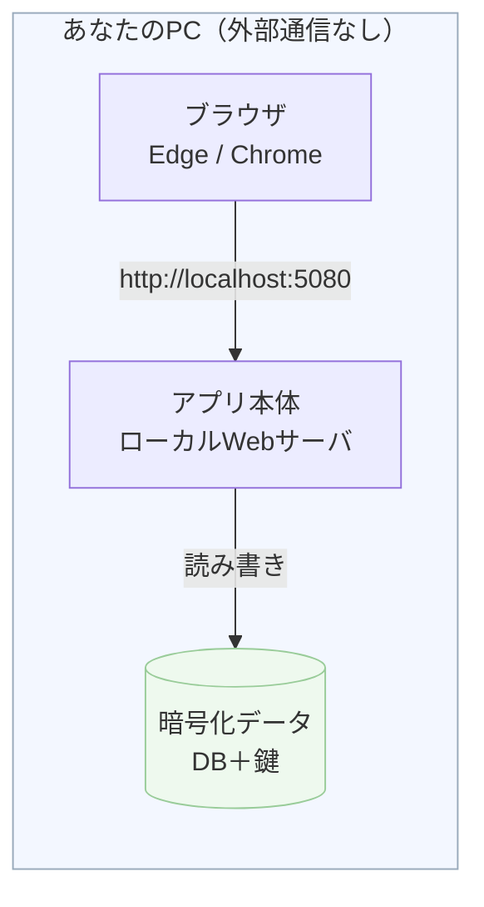
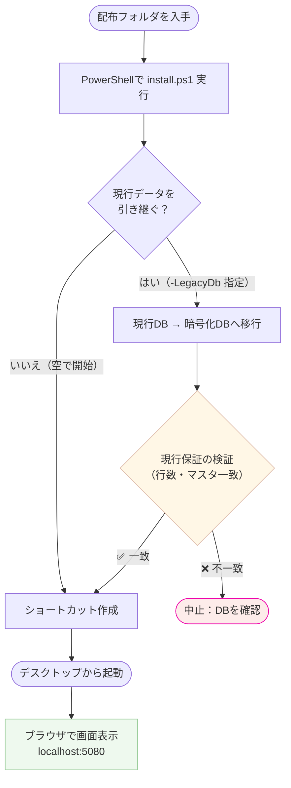
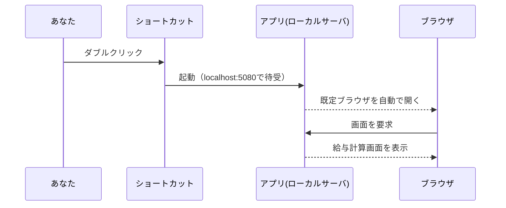
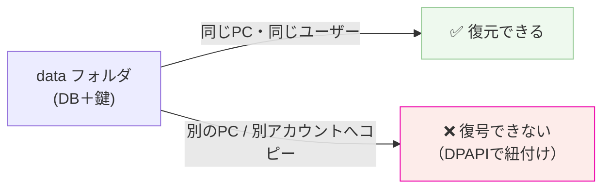
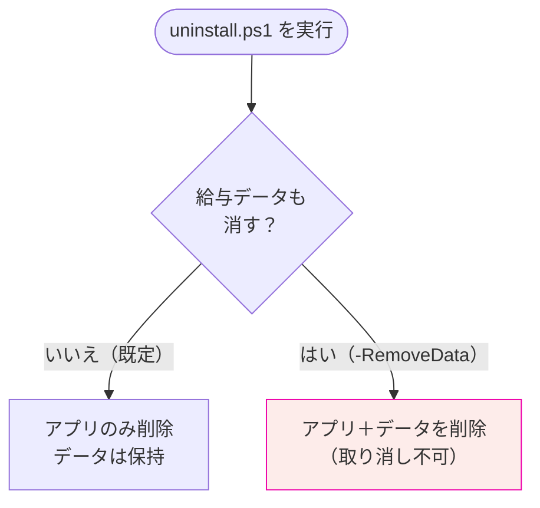
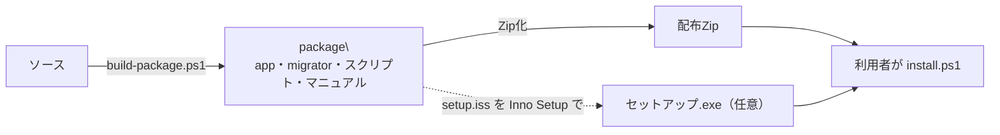

# 給与計算DXPro スタンドアロン版 セットアップマニュアル（図解版）

本書は、給与計算DXPro（ブラウザ版）を **1台のPCにインストールして使う**ための手順書です。
サーバは不要で、**.NET のインストールも不要**です（必要な実行環境はすべて同梱しています）。

> 📌 図について：処理の流れ・構成図は Mermaid 図（GitHub・VS Code 等で図として表示）、
> 画面・フォルダ・コンソール出力は枠囲みの図で示します。

---

## 1. システム構成の概要

アプリを起動すると、お使いのPCの中だけでWebサーバとブラウザがつながりWeb画面が開きます。
外部サーバ・インターネット・他PCとの通信は行いません。

**図1：システム構成**



- 給与DBは **SQLCipher** で暗号化。マイナンバーはさらに列単位で **AES-256-GCM** により二重暗号化。
- 暗号鍵は **Windows DPAPI**（インストールしたユーザー／PCに紐付け）で保護します。

---

## 2. 動作環境

| 項目 | 要件 |
|---|---|
| OS | Windows 10 / 11（64ビット） |
| ブラウザ | Microsoft Edge / Google Chrome など最新版 |
| .NET | **不要**（同梱） |
| 管理者権限 | **不要**（ユーザー領域にインストール） |
| ディスク空き | 約 300MB 以上 |

---

## 3. インストールから起動までの全体像

**図2：全体フロー**



---

## 4. インストール前の準備

1. 配布された **セットアップフォルダ**（または配布Zipを展開したフォルダ）を用意します。

   **図3：配布フォルダの中身**
   ```
   📁 PayCalcDXPro-Setup\
   ├─ 📄 install.ps1              ← インストール用
   ├─ 📄 uninstall.ps1           ← アンインストール用
   ├─ 📄 セットアップマニュアル.md  ← 本書
   ├─ 📄 README.md
   ├─ 📁 app\                     ← アプリ本体（同梱）
   └─ 📁 migrator\               ← 移行ツール（同梱）
   ```

2. **現行（デスクトップ版）のデータを引き継ぐ場合**は、現行データベースの場所を確認します。
   - 例：`C:\給与計算DX\DB\PayCalc2026.db`（環境により異なります）
   - 引き継がず新規で始める場合は不要です。

---

## 5. インストール手順

### 5-1. セットアップフォルダで PowerShell を開く

フォルダの空白部分で **Shift＋右クリック** → メニューから選びます。

**図5-1：右クリックメニュー**
```
┌─────────────────────────────────────┐
│  表示                              ▶ │
│  並べ替え                          ▶ │
│  ─────────────────────────────────  │
│  PowerShell ウィンドウをここで開く(S)  │ ←★これを選ぶ
│  ターミナルで開く(T)                  │ （Win11はこちらでも可）
│  ─────────────────────────────────  │
│  貼り付け                            │
└─────────────────────────────────────┘
```

### 5-2. インストールを実行

**図5-2：実行コマンド（現行データを引き継ぐ場合）**
```powershell
PS C:\...\PayCalcDXPro-Setup> .\install.ps1 -LegacyDb "C:\給与計算DX\DB\PayCalc2026.db"
```
- `-LegacyDb` の後ろは、ご自身の現行DBの実際のパスに置き換えてください。
- 新規（空）で始める場合は `.\install.ps1` のみ。
- 「スクリプトの実行が無効」と出た場合：
  ```powershell
  powershell -ExecutionPolicy Bypass -File .\install.ps1 -LegacyDb "C:\給与計算DX\DB\PayCalc2026.db"
  ```

### 5-3. 「現行保証」の確認

現行データを引き継ぐ場合、**移行前後でデータが完全一致するか**を自動検証します。

**図5-3：現行保証OKの表示**
```
┌──────────────────────────────────────────────┐
│ === 給与計算DXPro データ移行 ===                │
│ → 移行完了。現行保証の検証を行います...          │
│                                                │
│ [1] テーブル・行数の整合                         │
│     ✓ 全 48 テーブルの行数が一致                 │
│ [2] 計算マスタの一致（別表・料率・速算表 等）      │
│     ✓ 源泉徴収税額表(別表一〜四)                 │
│     ✓ 標準報酬月額表・雇用保険                   │
│     ✓ 公的年金等 速算表   …ほか                 │
│                                                │
│ ✅ 現行保証OK：移行データは現行と完全一致しました。│
└──────────────────────────────────────────────┘
```
> ❗ `❌ 現行保証NG` の場合はインストールを中止します。現行DBのパスや内容をご確認ください。

### 5-4. 完了

**図5-4：完了メッセージ**
```
✅ インストール完了。デスクトップの『給与計算DXPro』から起動してください。
```
デスクトップとスタートメニューに **「給与計算DXPro」** のショートカットが作成されます。

**図5-5：作成されるショートカット**
```
   ┌──────┐
   │  📊  │
   │      │   ← デスクトップ
   └──────┘
  給与計算DXPro
```

---

## 6. 起動と終了

**図6：起動の流れ**



起動すると数秒で既定ブラウザが開き、次の画面が表示されます。

**図6-1：起動後の画面（Home）**
```
┌────────────────────────────────────────────────────┐
│  給与計算DXPro ブラウザ版                              │
│  ドメイン計算とサーバ側PDF生成を Blazor から呼び出すデモ │
│  ┌──────────────────────────────────────────────┐  │
│  │ ✅ ローカルDB：接続OK（現行データ移行済み）        │  │ ← 緑＝正常
│  │    ｜ 従業員 120 名 ｜ テーブル 48              │  │
│  │    データ格納先: C:\Users\...\PayCalcDXPro\data  │  │
│  └──────────────────────────────────────────────┘  │
│  課税支給合計 [300000]  標準報酬月額 [300000] …       │
│  [ 計算する ]                                         │
└────────────────────────────────────────────────────┘
```
> 上部のバナーが **緑「接続OK」** なら正常です。赤「未移行：データがありません」の場合は第8章で移行します。

- **終了**：ブラウザを閉じ、起動時に開いた黒いコンソール窓を閉じます。

> 💡 起動直後に「Windows によって PC が保護されました（SmartScreen）」が出たら、
> 「**詳細情報**」→「**実行**」で起動できます（社内配布の未署名アプリのため）。

---

## 7. データの保存場所とバックアップ

**図7：インストール後のフォルダと保存先**
```
%LOCALAPPDATA%\
├─ Programs\PayCalcDXPro\        ← アプリ本体
│   ├─ app\                       （PayCalcDXPro.Web.exe ほか）
│   └─ migrator\                  （移行ツール）
└─ PayCalcDXPro\data\            ← 給与データ（★バックアップ対象）
    ├─ PayCalcDXPro.db            暗号化された給与DB
    └─ keys\                      DPAPI保護の暗号鍵
```

**バックアップ**：`%LOCALAPPDATA%\PayCalcDXPro\data` フォルダ一式をコピー保管してください。

**図7-1：暗号鍵の制約（重要）**

> ⚠️ 別PCへ引っ越す場合は、コピーではなく**引っ越し先で改めて現行DBから移行**（第8章）してください。

---

## 8. 現行データを後から移行する

インストール後に移行（やり直し）する場合は、移行ツールを直接実行します。

**図8：移行ツールの実行**
```powershell
& "$env:LOCALAPPDATA\Programs\PayCalcDXPro\migrator\PayCalcDXPro.Migrator.exe" `
  --legacy "C:\給与計算DX\DB\PayCalc2026.db" `
  --out "$env:LOCALAPPDATA\PayCalcDXPro\data" --force
```
- 終了コード **0**＝現行保証OK／**1**＝不一致あり。
- `--force` は既存データを置き換えます（実行前にバックアップ推奨）。

---

## 9. アンインストール

**図9：アンインストールの選択**


```powershell
.\uninstall.ps1              # アプリのみ削除（給与データは残す）
.\uninstall.ps1 -RemoveData  # 給与データも完全に削除（取り消し不可）
```

---

## 10. トラブルシューティング

| 症状 | 対処 |
|---|---|
| スクリプトが実行できない | `powershell -ExecutionPolicy Bypass -File .\install.ps1 ...` で実行 |
| SmartScreenの警告が出る | 「詳細情報」→「実行」。配布元が信頼できることを確認のうえ実行 |
| ブラウザが自動で開かない | ブラウザを手動で開き `http://localhost:5080` を入力 |
| 画面が赤「未移行：データがありません」 | 第8章の移行ツールで現行DBから移行 |
| ポート5080が使用中 | 既存の別アプリを終了するか、配布担当へポート変更を依頼（付録参照） |
| 「現行保証NG」で中止 | 現行DBのパス・破損有無を確認し、正しいDBで再実行 |
| 起動してもすぐ閉じる | コンソール窓のエラー文を確認し配布担当へ連絡 |

---

## 11. セキュリティ

**図11：データ保護の多層防御**
```
            ┌─────────────────────────────────────┐
   外側 →   │ ① DB全体を SQLCipher で暗号化          │
            │   ┌───────────────────────────────┐ │
            │   │ ② マイナンバー列を AES-256-GCM   │ │
            │   │    で二重暗号化                  │ │
            │   └───────────────────────────────┘ │
            │ ③ 暗号鍵は Windows DPAPI で保護        │
            │    （ユーザー／PCに紐付け）            │
            └─────────────────────────────────────┘
   ④ 利用者ロール：管理者／給与担当／マイナンバー閲覧 を分離
      （全桁表示は権限者のみ・参照は操作ログに記録）
```

---

## 12. 配布担当者向け：パッケージ作成

開発機（.NET 8 SDK と、様式更新時のみ LibreOffice）で実行します。

**図12：配布までの流れ**


```powershell
.\build-package.ps1
```
- 出力：`deploy\standalone\package\`（`app\`・`migrator\`・各スクリプト・マニュアル）
- 配布：このフォルダをZip化して利用者へ渡す。
- `.exe` インストーラにする場合は `setup.iss` を [Inno Setup](https://jrsoftware.org/isinfo.php) でコンパイル。

> 配布の信頼性向上のため、可能であれば実行ファイルへの**コード署名**を推奨します（SmartScreen警告の抑制）。

---

## 付録：待受ポートの変更

既定は `http://localhost:5080`。変更する場合は `app\appsettings.Production.json` を編集します。
```json
{ "PayCalc": { "Standalone": true, "Url": "http://localhost:5099" } }
```

---

> 📷 実機スクリーンショットの差し込み位置（任意）：図5-1〜5-5、図6-1 の枠図の箇所に、
> 実際のキャプチャ画像を `images\` フォルダへ置いて `` の形で
> 差し替えると、より分かりやすい配布版になります。
